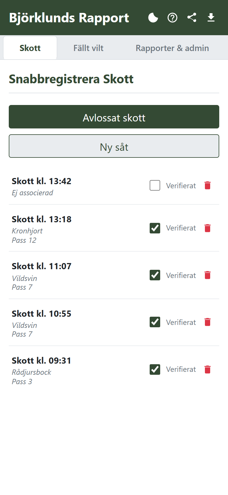
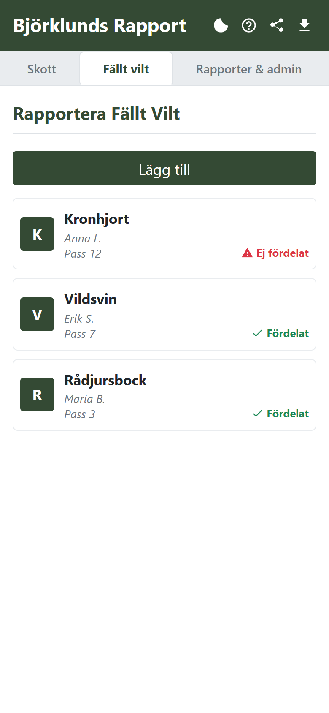
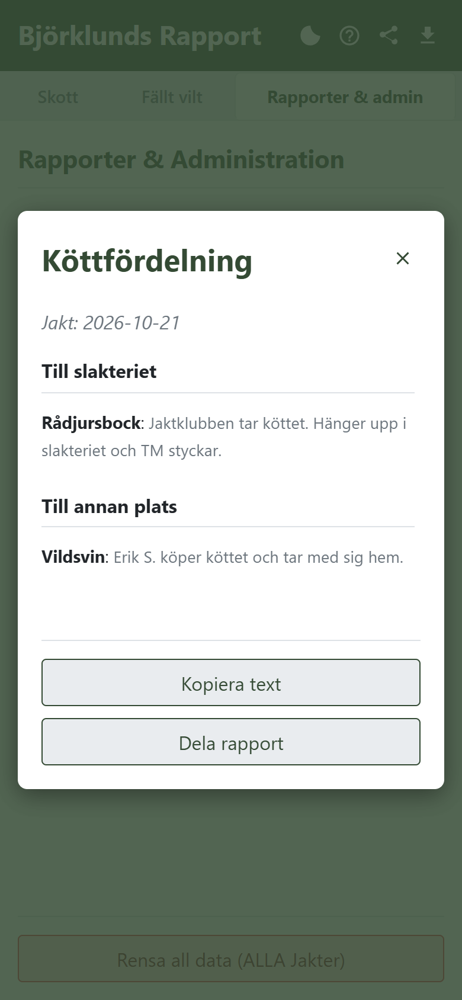

# Björklunds Rapport

Webbapp (PWA) för att rapportera skott och fällt vilt under jakt. Den körs i
mobilens webbläsare, kan installeras på hemskärmen och fungerar utan
täckning ute i skogen.

**Öppna appen:** <https://stevoxa.github.io/bjorklunds-rapport/>

<p>
  
  
  
</p>

## Vad appen gör

- **Skott:** ett tryck på *Avlossat skott* loggar klockslaget. *Ny såt*
  delar in skotten per såt. Varje skott kan verifieras och kopplas till
  ett fällt vilt.
- **Fällt vilt:** viltslag, skytt, pass, tid och köttfördelning, med
  snabbval för vanliga fördelningar. Visar direkt vilket vilt som ännu inte
  är fördelat.
- **Rapporter & admin:**
  - Köttfördelningen sammanställs per jakt och kan kopieras eller delas
    som text.
  - Hela jakten kan exporteras som CSV, anpassad för svensk Excel.
  - Varje jakttillfälle sparas för sig och kan öppnas igen eller tas bort.
- **Dela appen** med QR-kod, plus ljust och mörkt tema.

All data sparas lokalt i webbläsaren (`localStorage`) på den enhet där den
matas in. Inget skickas till någon server. Data som rensas, eller ligger
på en annan telefon, finns alltså inte kvar någon annanstans. Exportera
CSV om något ska sparas.

## Installera på mobilen

- **Android (Chrome):** meny ⋮ → *Installera appen* eller *Lägg till på
  startskärmen*.
- **iPhone (Safari):** Dela-knappen → *Lägg till på hemskärmen*.

Appens hjälpsida (knappen högst upp) beskriver alla funktioner i detalj.

## Teknik

Ingen byggprocess och inga beroenden att installera:

| Fil | Innehåll |
| --- | --- |
| `index.html` | Hela appen: HTML, CSS och JavaScript |
| `sw.js` | Service worker. Sidan hämtas från nätet i första hand och från cachen utan nät, övriga filer från cachen |
| `manifest.json` | PWA-manifest: namn, ikoner, färger |
| `videos/intro.mp4` | Introfilm (4 s, 720×1280, utan ljud) som spelas högst en gång per dag. Den cachas inte och hoppas över utan nät |

QR-koden genereras med [QRious](https://github.com/neocotic/qrious), som
laddas från cdnjs och cachas för offlinebruk.

### Köra lokalt

Service workern kräver `http://localhost` eller HTTPS. Att öppna filen
direkt fungerar inte. Kör i repots rot:

```bash
python -m http.server 8000
```

Öppna sedan <http://localhost:8000>.

### Publicering

GitHub Pages publicerar `main` direkt från rotkatalogen. Höj
`CACHE_NAME` i `sw.js` när ikoner, manifest eller QRious-versionen ändras.
`index.html` hämtas alltid färskt när det finns nät.

## Licens

[MIT](LICENSE)
